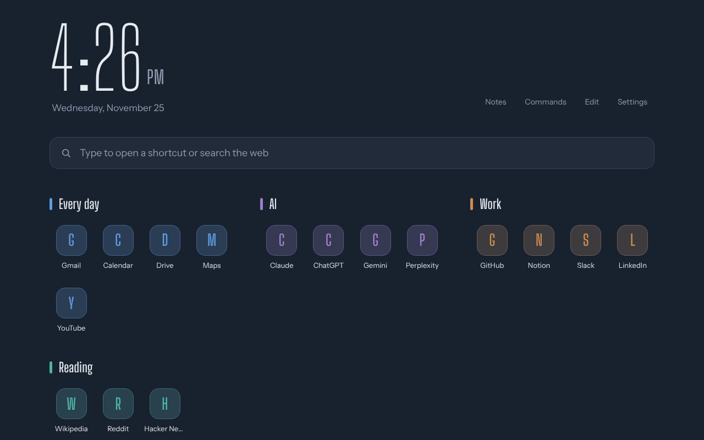

# Forge Tab

A fast, calm new tab page for Chrome. Put as many shortcuts as you want into named groups, open any of them by typing, and keep notes and terminal commands one click away.

## Features

- **Unlimited shortcuts in groups.** Drag to reorder or move between groups. Colour-coded groups you can rename.
- **Type to launch.** Start typing anywhere on the page. Matching shortcuts and commands come up first, and everything else searches with your default search engine.
- **Custom icons.** Use the site's own icon, a letter, an emoji, an image file, or fetch a sharp logo from any website.
- **Notes.** Quick notes that save as you type, with pins, colours and search.
- **Commands.** Save terminal commands for Windows, Linux or Mac and copy them with one click. Put a word in braces, like `{port}`, and you'll be asked for it when you copy.
- **Status checks.** Small chips next to the clock show whether your sites, home server or Ollama models are up.
- **Backup.** Export your whole layout to a file and import it on another computer.

## Install

**From the Chrome Web Store:** coming soon.

**From this repo:**

1. Download this repo (Code → Download ZIP) and unzip it.
2. Open `chrome://extensions` and turn on **Developer mode**.
3. Click **Load unpacked** and choose the `extension` folder.
4. Open a new tab.

## Privacy

Forge Tab has no account, no analytics and no servers. Your layout, notes and commands stay in Chrome on your computer. It only contacts a website when you fetch a logo or add a status check for it. Details are in [PRIVACY.md](PRIVACY.md).

## Permissions

| Permission | Why |
|---|---|
| Storage | Saves your layout, notes and commands in Chrome. |
| Favicon | Shows each site's icon on its shortcut. |
| Search | Sends searches to your default search engine. |
| Read websites (optional) | Asked only the first time you fetch a logo or add an Ollama check. |

## Building a Web Store zip

On Windows, double-click `Package.cmd`. It makes `forge-tab.zip` from the `extension` folder.

## Credits

Made by [Forge Stack Partners](https://forgestackpartners.com). Fonts: Big Shoulders and Instrument Sans, under the SIL Open Font License.

## License

MIT. See [LICENSE](LICENSE).
